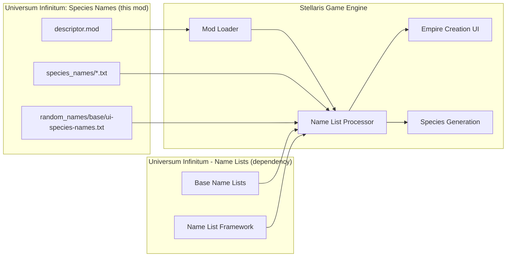
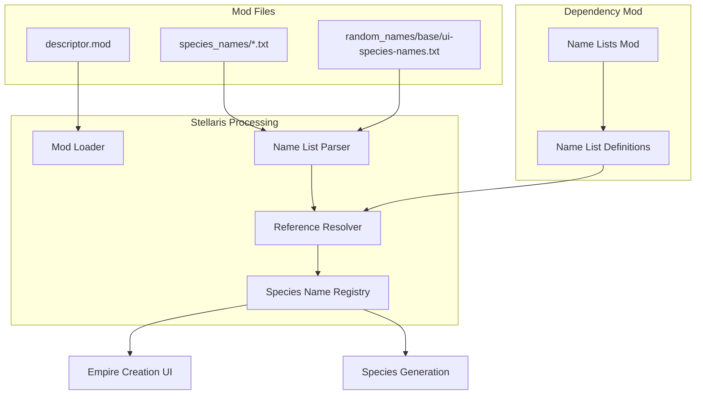
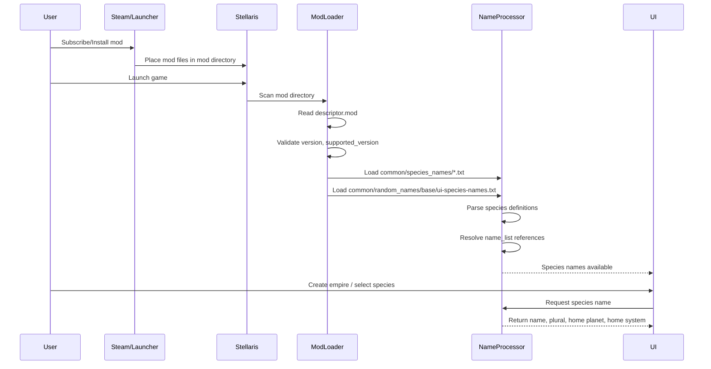
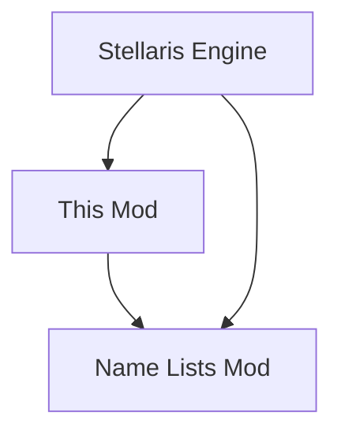

# Universum Infinitum: Species Names Architecture

This document describes the current architecture of Universum Infinitum: Species Names, a static Stellaris mod. It defines the system boundary, data structure, integration with Stellaris, and dependency on Universum Infinitum - Name Lists. Detailed implementation-level architecture is documented in [docs/architecture.md](docs/architecture.md).

## 📑 Table of Contents

- [Purpose](#-purpose)
- [System Context](#-system-context)
- [Architectural Style](#️-architectural-style)
- [Runtime Flow](#-runtime-flow)
- [Architectural Areas](#-architectural-areas)
- [Data Architecture](#-data-architecture)
- [Interfaces and Integrations](#-interfaces-and-integrations)
- [Key Flows](#-key-flows)
- [Cross-Cutting Concerns](#-cross-cutting-concerns)
- [Dependency Direction and Rules](#-dependency-direction-and-rules)
- [External Dependencies](#-external-dependencies)
- [Deployment and Operations](#-deployment-and-operations)
- [Compatibility Contracts](#-compatibility-contracts)
- [Testing and Verification](#-testing-and-verification)
- [Design Constraints](#-design-constraints)
- [Related Documentation](#-related-documentation)

## 🎯 Purpose

Universum Infinitum: Species Names is a static data mod for Stellaris that adds hundreds of new species names across all vanilla species classes and media-themed packs. This architecture document describes the mod's structure, its integration with the Stellaris engine, and its dependency on the Universum Infinitum - Name Lists mod. The intended audience includes mod maintainers, contributors, and users seeking to understand the mod's technical boundaries.

## 🌐 System Context

Universum Infinitum: Species Names is a **static data mod** for Stellaris. It has no executable code, no runtime process, and no network communication. The mod consists entirely of text files that Stellaris reads at startup and during gameplay.



The principal external boundaries are:
- **Stellaris Mod Loader:** Inbound read of mod metadata (version, name, supported_version, tags, path); owned by Stellaris
- **Stellaris Name List Processor:** Inbound read of species name definitions and modification prefixes/postfixes; owned by Stellaris
- **Universum Infinitum - Name Lists:** Dependency requiring name list references (e.g., `ui_extra_art1`, `ui_dnd_kobold`); owned by separate mod
- **Distribution Platforms:** Outbound publish of mod archive (zip) with descriptor and data files; owned by platform operators

## 🏗️ Architectural Style

**Static Data Mod / Declarative Configuration**

This mod follows a pure data-driven architecture:
- **No executable code** — All behaviour is defined by Stellaris engine interpreting declarative data files
- **Declarative format** — Species definitions use Stellaris's custom key-value syntax
- **Host-dependent execution** — Stellaris owns the runtime; this mod provides data only
- **Additive extension** — Mod adds new species without modifying base game files
- **Dependency-chained** — Requires Name Lists mod for name list references to resolve

Consequences:
- **Zero runtime overhead** — No performance impact beyond file I/O at load time
- **Cross-platform by default** — Text files work identically on Windows, Linux, macOS
- **Version coupling** — Mod `supported_version` must match Stellaris version
- **Dependency coupling** — Name list references must exist in dependency mod



The principal architecture boundaries are:
- **Mod Data Layer:** Owns all species definitions, prefixes, postfixes; no dependencies on other mod layers
- **Stellaris Integration Layer:** Mod loader, name list parser, reference resolver; owned by Stellaris engine
- **Dependency Layer:** Name list definitions; owned by Universum Infinitum - Name Lists mod

## 🔄 Runtime Flow



The principal runtime sequence is:
1. **Mod installation** — User installs mod via Steam Workshop, Paradox Mods, Nexus Mods, or manual GitHub release
2. **Game launch** — Stellaris starts and scans mod directory
3. **Descriptor validation** — Mod loader reads `descriptor.mod`, checks `supported_version` compatibility
4. **Data loading** — Name list processor reads all `common/species_names/*.txt` and `common/random_names/base/ui-species-names.txt`
5. **Reference resolution** — Processor resolves `name_list` references against loaded name lists (including dependency mod)
6. **UI integration** — Species names become available in empire creation and species selection menus
7. **Runtime usage** — When player creates empire or game generates species, Stellaris selects from available name lists

## 🗂️ Architectural Areas

### Species Name Definitions

Paths:
- `ui-species-names/common/species_names/ui_species_extra_arthropoid.txt`
- `ui-species-names/common/species_names/ui_species_extra_avian.txt`
- `ui-species-names/common/species_names/ui_species_extra_fungoid.txt`
- `ui-species-names/common/species_names/ui_species_extra_humanoid.txt`
- `ui-species-names/common/species_names/ui_species_extra_mammalian.txt`
- `ui-species-names/common/species_names/ui_species_extra_molluscoid.txt`
- `ui-species-names/common/species_names/ui_species_extra_plantoid.txt`
- `ui-species-names/common/species_names/ui_species_extra_reptilian.txt`
- `ui-species-names/common/species_names/ui_species_media_distant-worlds.txt`
- `ui-species-names/common/species_names/ui_species_media_dnd.txt`
- `ui-species-names/common/species_names/ui_species_media_elder-scrolls.txt`
- `ui-species-names/common/species_names/ui_species_media_galciv.txt`
- `ui-species-names/common/species_names/ui_species_media_narivia.txt`

Responsibilities:
- Define species name entries for each species class or media theme
- Provide singular/plural names, home planet, home system
- Reference name lists from Name Lists mod via `name_list` field

Boundary rules:
- Must use valid Stellaris species class categories (ART, AVI, FUN, HUM, MAM, MOL, PLA, REP) or custom categories for media packs
- `name_list` references must exist in Universum Infinitum - Name Lists mod
- Species keys must be unique within the mod (lowercase, no spaces)
- File encoding: UTF-8, line endings: LF

### Random Name Prefixes/Postfixes

Paths:
- `ui-species-names/common/random_names/base/ui-species-names.txt`

Responsibilities:
- Define prefixes for genetically modified species names (e.g., "Alpha_", "Prime_")
- Define postfixes for genetically modified species names (e.g., "Magnus", "Primus")

Boundary rules:
- Prefixes should end with underscore or hyphen for proper concatenation
- Postfixes are appended directly
- Used by Stellaris during genetic modification events

### Mod Descriptors

Paths:
- `ui-species-names.mod` (distribution)
- `ui-species-names/descriptor.mod` (Stellaris launcher)

Responsibilities:
- Provide mod metadata to Stellaris and distribution platforms
- Define version, name, supported game version, tags, install path

Boundary rules:
- Both files must have identical content
- `supported_version` must match target Stellaris version (currently `4.5.*`)
- `path` must be `mod/ui-species-names` for correct installation

## 💾 Data Architecture


| Data or Store | Owner | Representation and Storage | Lifecycle or Consistency |
|---------------|-------|----------------------------|--------------------------|
| Mod metadata | This mod | `descriptor.mod` (key-value text) | Static, read at game startup |
| Species definitions | This mod | `species_names/*.txt` (Stellaris declarative syntax) | Static, parsed at game startup |
| Modification prefixes/postfixes | This mod | `random_names/base/ui-species-names.txt` | Static, parsed at game startup |
| Name list definitions | Name Lists mod | `common/random_names/*.txt` | Static, parsed at game startup |
| Resolved species registry | Stellaris engine | In-memory registry | Runtime, rebuilt each game session |

### Data Flow

1. **Source**: Mod text files (UTF-8, LF)
2. **Parse**: Stellaris parser reads declarative syntax
3. **Resolve**: `name_list` references matched against Name Lists mod
4. **Register**: Valid species entries added to in-memory registry
5. **Consume**: UI and game systems query registry for names

## 🔌 Interfaces and Integrations

| Interface or Integration | Direction | Contract | Owner | Failure Semantics |
|--------------------------|-----------|----------|-------|-------------------|
| Stellaris Mod Loader | Inbound | `descriptor.mod` format | Stellaris | Mod ignored, error in launcher log |
| Stellaris Name List Parser | Inbound | Species definition syntax | Stellaris | Species skipped, error in game log |
| Name Lists Mod | Dependency | `name_list` references | Name Lists mod | Unresolved references → species unavailable |
| Steam Workshop | Outbound | Mod archive + descriptor | Steam | Upload fails, mod not published |
| Paradox Mods | Outbound | Mod archive + descriptor | Paradox | Upload fails, mod not published |
| Nexus Mods | Outbound | Mod archive + descriptor | Nexus | Upload fails, mod not published |
| GitHub Releases | Outbound | Release assets | GitHub | Release creation fails |

## 🔀 Key Flows

### Mod Loading Flow

See [docs/flows/mod-loading.md](docs/flows/mod-loading.md) for detailed sequence.

### Species Generation Flow

See [docs/flows/species-generation.md](docs/flows/species-generation.md) for detailed sequence.

## 🧵 Cross-Cutting Concerns

### Configuration

| Configuration Area | Source | Responsibility | Override or Secret Policy |
|--------------------|--------|----------------|---------------------------|
| Mod version | `descriptor.mod` / `ui-species-names.mod` | Version identification | Must match in both files |
| Supported game version | `descriptor.mod` / `ui-species-names.mod` | Compatibility declaration | Single value, no override |
| Mod install path | `descriptor.mod` / `ui-species-names.mod` | Installation location | Fixed: `mod/ui-species-names` |
| Mod tags | `descriptor.mod` / `ui-species-names.mod` | Categorisation | Single value: `Species` |

### Error Handling

| Failure Point | Detection | Handling | User Impact |
|---------------|-----------|----------|-------------|
| Invalid `supported_version` | Launcher startup | Mod disabled, warning in launcher | Mod not available |
| Syntax error in species file | Game startup / mod load | Species skipped, error in log | Missing species names |
| Unresolved `name_list` reference | Game startup / mod load | Species skipped, error in log | Missing species names |
| Duplicate species keys | Game startup / mod load | Undefined (last wins) | Potential name conflicts |
| Missing dependency mod | Game startup | Name lists unavailable | All species from this mod unavailable |

### Observability

- **Launcher logs**: Mod load success/failure, version validation
- **Game logs**: Species parsing errors, unresolved references
- **No custom logging** — Mod has no executable code

## 🧭 Dependency Direction and Rules



The principal dependency rules are:
- **Stellaris → This mod**: Stellaris reads mod files (one-way, host reads extension)
- **This mod → Name Lists mod**: This mod references name lists defined in dependency (one-way, extension depends on framework)
- **No reverse dependencies** — Neither Stellaris nor Name Lists mod depends on this mod
- **No circular dependencies** — Linear dependency chain

### Prohibited Coupling

- This mod must not modify Stellaris base game files
- This mod must not include executable code (scripts, DLLs, etc.)
- This mod must not define name lists (delegated to Name Lists mod)

## 📦 External Dependencies

| Dependency | Responsibility | Integration Boundary | Architectural Consequence |
|------------|----------------|----------------------|---------------------------|
| Stellaris 4.5.x | Host application, mod loader, name list processor | Mod directory scan, file parsing | Version coupling via `supported_version` |
| Universum Infinitum - Name Lists | Name list definitions (`ui_extra_art1`, `ui_dnd_kobold`, etc.) | `name_list` field references | Reference coupling — unresolved refs break species |
| Steam Workshop | Distribution platform | Mod upload, user subscription | Platform-specific packaging |
| Paradox Mods | Distribution platform | Mod upload, launcher integration | Platform-specific metadata |
| Nexus Mods | Distribution platform | Mod upload, manual install | Platform-specific packaging |
| GitHub Releases | Distribution platform | Release assets, manual download | Direct file distribution |

## 🚀 Deployment and Operations

| Concern | Current Design | Architectural Consequence |
|---------|----------------|---------------------------|
| Process topology | None (static files) | No runtime process to manage |
| Deployment unit | Mod directory (`ui-species-names/`) | Simple file copy installation |
| Persistent state | None | No migration, no backup needed |
| Filesystem requirements | Read access to mod directory | Standard user permissions sufficient |
| Network requirements | None | Works offline |

## 🛡️ Compatibility Contracts

| Contract | Owner | Invariant | Verification | Change Policy |
|----------|-------|-----------|--------------|---------------|
| `descriptor.mod` format | Stellaris | Key-value structure, required fields | Launcher validation | Backward compatible only |
| Species definition syntax | Stellaris | Declarative key-value, required fields | Game log errors | Backward compatible only |
| `name_list` references | Name Lists mod | Reference must exist in dependency | Game log errors | Additive only (new refs require dependency update) |
| Mod version scheme | This mod | Semantic versioning (MAJOR.MINOR.PATCH) | Release tags | Semantic versioning rules |

## ✅ Testing and Verification

This mod has no executable code, so traditional automated testing does not apply. Verification is manual and platform-based:

| Verification Level | Scope | Method |
|--------------------|-------|--------|
| Syntax validation | All `.txt` files | Stellaris launcher load test |
| Reference resolution | All `name_list` fields | In-game empire creation test |
| Distribution packaging | Release archives | Platform upload validation |
| Version compatibility | `supported_version` field | Test against target Stellaris version |

Execute the principal automated verification with:

```bash
# No automated test suite — static data mod
# Manual verification steps:
# 1. Install mod in Stellaris 4.5.x
# 2. Launch game, verify mod loads without errors
# 3. Create empire, verify new species names appear
# 4. Verify genetic modification prefixes/postfixes work
```

## 🚫 Design Constraints

| Constraint | Rationale | Impact |
|------------|-----------|--------|
| No executable code | Stellaris mod policy, security | Pure data-driven, no custom logic |
| UTF-8, LF line endings | Cross-platform compatibility | Consistent parsing on all OSes |
| `supported_version` = `4.5.*` | Stellaris version coupling | Must update for each major Stellaris release |
| Dependency on Name Lists mod | Architectural separation of concerns | Cannot function standalone |
| Additive only (no base game overrides) | Mod compatibility, stability | Cannot modify existing species |

## 📚 Related Documentation

| Document | Scope |
|----------|-------|
| [docs/architecture.md](docs/architecture.md) | Detailed implementation-level architecture |
| [docs/data-model.md](docs/data-model.md) | Species definition data model |
| [docs/dependencies.md](docs/dependencies.md) | Dependency management |
| [docs/flows/mod-loading.md](docs/flows/mod-loading.md) | Mod loading sequence |
| [docs/flows/species-generation.md](docs/flows/species-generation.md) | Species generation sequence |
| [README.md](README.md) | Project overview, installation, usage |
| [CONTRIBUTING.md](CONTRIBUTING.md) | Contribution guidelines |