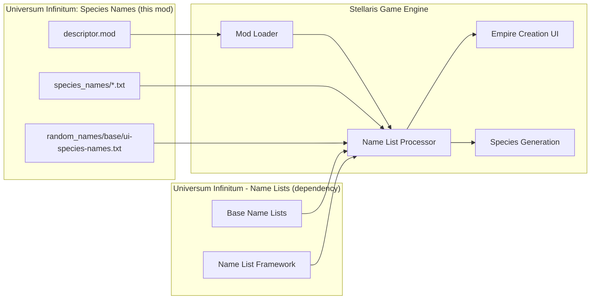
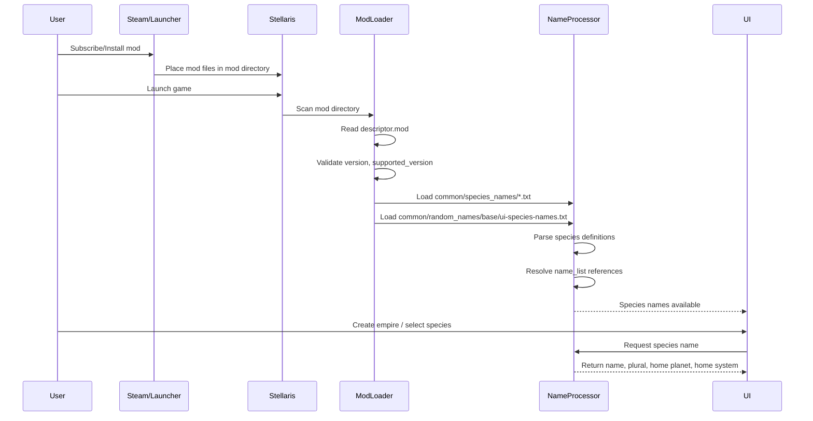
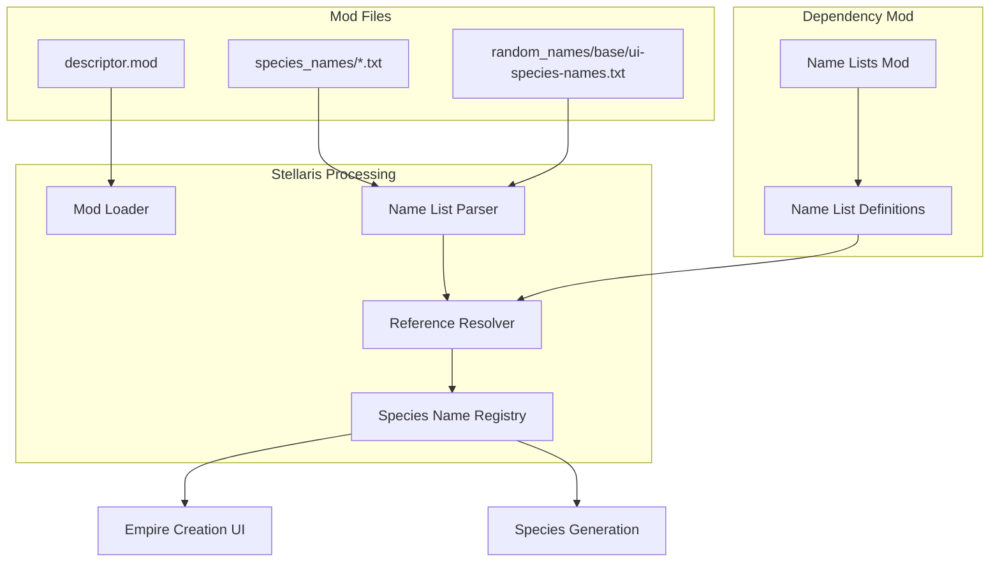
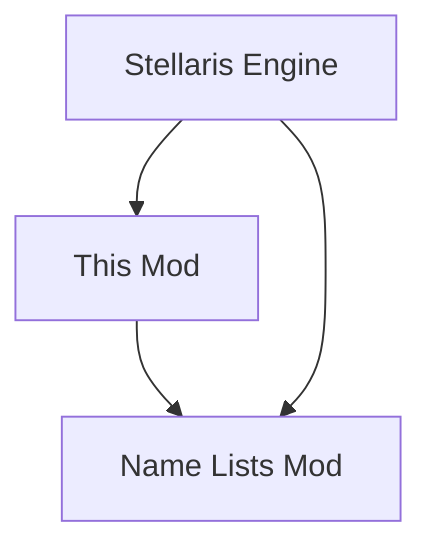

# Architecture

## Purpose

This document describes the architecture of Universum Infinitum: Species Names, a static Stellaris mod. It complements the root ARCHITECTURE.md (when created) by providing implementation-level detail specific to this mod's data structure and integration with Stellaris.

## System Context

Universum Infinitum: Species Names is a **static data mod** for Stellaris. It has no executable code, no runtime process, and no network communication. The mod consists entirely of text files that Stellaris reads at startup and during gameplay.



### Principal External Boundaries

| Boundary | Interaction | Exchanged Information | Ownership |
|----------|-------------|----------------------|-----------|
| Stellaris Mod Loader | Inbound (read) | Mod metadata (version, name, supported_version, tags, path) | Stellaris |
| Stellaris Name List Processor | Inbound (read) | Species name definitions, modification prefixes/postfixes | Stellaris |
| Universum Infinitum - Name Lists | Dependency (requires) | Name list references (e.g., `ui_extra_art1`, `ui_dnd_kobold`) | Separate mod |
| Distribution Platforms | Outbound (publish) | Mod archive (zip) with descriptor and data files | Platform operators |

## Architectural Style

**Static Data Mod / Declarative Configuration**

This mod follows a pure data-driven architecture:
- **No executable code** — All behaviour is defined by Stellaris engine interpreting declarative data files
- **Declarative format** — Species definitions use Stellaris's custom key-value syntax
- **Host-dependent execution** — Stellaris owns the runtime; this mod provides data only
- **Additive extension** — Mod adds new species without modifying base game files
- **Dependency-chained** — Requires Name Lists mod for name list references to resolve

Consequences:
- **Zero runtime overhead** — No performance impact beyond file I/O at load time
- **Cross-platform by default** — Text files work identically on Windows, Linux, macOS
- **Version coupling** — Mod `supported_version` must match Stellaris version
- **Dependency coupling** — Name list references must exist in dependency mod

## Runtime Flow



### Principal Runtime Sequence

1. **Mod installation** — User installs mod via Steam Workshop, Paradox Mods, Nexus Mods, or manual GitHub release
2. **Game launch** — Stellaris starts and scans mod directory
3. **Descriptor validation** — Mod loader reads `descriptor.mod`, checks `supported_version` compatibility
4. **Data loading** — Name list processor reads all `common/species_names/*.txt` and `common/random_names/base/ui-species-names.txt`
5. **Reference resolution** — Processor resolves `name_list` references against loaded name lists (including dependency mod)
6. **UI integration** — Species names become available in empire creation and species selection menus
7. **Runtime usage** — When player creates empire or game generates species, Stellaris selects from available name lists

## Architectural Areas

### Species Name Definitions

**Paths:**
- `ui-species-names/common/species_names/ui_species_extra_arthropoid.txt`
- `ui-species-names/common/species_names/ui_species_extra_avian.txt`
- `ui-species-names/common/species_names/ui_species_extra_fungoid.txt`
- `ui-species-names/common/species_names/ui_species_extra_humanoid.txt`
- `ui-species-names/common/species_names/ui_species_extra_mammalian.txt`
- `ui-species-names/common/species_names/ui_species_extra_molluscoid.txt`
- `ui-species-names/common/species_names/ui_species_extra_plantoid.txt`
- `ui-species-names/common/species_names/ui_species_extra_reptilian.txt`
- `ui-species-names/common/species_names/ui_species_media_distant-worlds.txt`
- `ui-species-names/common/species_names/ui_species_media_dnd.txt`
- `ui-species-names/common/species_names/ui_species_media_elder-scrolls.txt`
- `ui-species-names/common/species_names/ui_species_media_galciv.txt`
- `ui-species-names/common/species_names/ui_species_media_narivia.txt`

**Responsibilities:**
- Define species name entries for each species class or media theme
- Provide singular/plural names, home planet, home system
- Reference name lists from Name Lists mod via `name_list` field

**Boundary Rules:**
- Must use valid Stellaris species class categories (ART, AVI, FUN, HUM, MAM, MOL, PLA, REP) or custom categories for media packs
- `name_list` references must exist in Universum Infinitum - Name Lists mod
- Species keys must be unique within the mod (lowercase, no spaces)
- File encoding: UTF-8, line endings: LF

### Random Name Prefixes/Postfixes

**Paths:**
- `ui-species-names/common/random_names/base/ui-species-names.txt`

**Responsibilities:**
- Define prefixes for genetically modified species names (e.g., "Alpha_", "Prime_")
- Define postfixes for genetically modified species names (e.g., "Magnus", "Primus")

**Boundary Rules:**
- Prefixes should end with underscore or hyphen for proper concatenation
- Postfixes are appended directly
- Used by Stellaris during genetic modification events

### Mod Descriptors

**Paths:**
- `ui-species-names.mod` (distribution)
- `ui-species-names/descriptor.mod` (Stellaris launcher)

**Responsibilities:**
- Provide mod metadata to Stellaris and distribution platforms
- Define version, name, supported game version, tags, install path

**Boundary Rules:**
- Both files must have identical content
- `supported_version` must match target Stellaris version (currently `4.5.*`)
- `path` must be `mod/ui-species-names` for correct installation

## Data Architecture



### Data Models

| Data | Owner | Representation | Lifecycle |
|------|-------|----------------|-----------|
| Mod metadata | This mod | `descriptor.mod` (key-value text) | Static, read at game startup |
| Species definitions | This mod | `species_names/*.txt` (Stellaris declarative syntax) | Static, parsed at game startup |
| Modification prefixes/postfixes | This mod | `random_names/base/ui-species-names.txt` | Static, parsed at game startup |
| Name list definitions | Name Lists mod | `common/random_names/*.txt` | Static, parsed at game startup |
| Resolved species registry | Stellaris engine | In-memory registry | Runtime, rebuilt each game session |

### Data Flow

1. **Source**: Mod text files (UTF-8, LF)
2. **Parse**: Stellaris parser reads declarative syntax
3. **Resolve**: `name_list` references matched against Name Lists mod
4. **Register**: Valid species entries added to in-memory registry
5. **Consume**: UI and game systems query registry for names

## Interfaces and Integrations

| Interface | Direction | Contract | Owner | Failure Semantics |
|-----------|-----------|----------|-------|-------------------|
| Stellaris Mod Loader | Inbound | `descriptor.mod` format | Stellaris | Mod ignored, error in launcher log |
| Stellaris Name List Parser | Inbound | Species definition syntax | Stellaris | Species skipped, error in game log |
| Name Lists Mod | Dependency | `name_list` references | Name Lists mod | Unresolved references → species unavailable |
| Steam Workshop | Outbound | Mod archive + descriptor | Steam | Upload fails, mod not published |
| Paradox Mods | Outbound | Mod archive + descriptor | Paradox | Upload fails, mod not published |
| Nexus Mods | Outbound | Mod archive + descriptor | Nexus | Upload fails, mod not published |
| GitHub Releases | Outbound | Release assets | GitHub | Release creation fails |

## Key Flows

### Mod Loading Flow

See [flows/mod-loading.md](./flows/mod-loading.md) for detailed sequence.

### Species Generation Flow

See [flows/species-generation.md](./flows/species-generation.md) for detailed sequence.

## Cross-Cutting Concerns

### Configuration

| Configuration Area | Source | Responsibility | Override Policy |
|--------------------|--------|----------------|-----------------|
| Mod version | `descriptor.mod` / `ui-species-names.mod` | Version identification | Must match in both files |
| Supported game version | `descriptor.mod` / `ui-species-names.mod` | Compatibility declaration | Single value, no override |
| Mod install path | `descriptor.mod` / `ui-species-names.mod` | Installation location | Fixed: `mod/ui-species-names` |
| Mod tags | `descriptor.mod` / `ui-species-names.mod` | Categorisation | Single value: `Species` |

### Error Handling

| Failure Point | Detection | Handling | User Impact |
|---------------|-----------|----------|-------------|
| Invalid `supported_version` | Launcher startup | Mod disabled, warning in launcher | Mod not available |
| Syntax error in species file | Game startup / mod load | Species skipped, error in log | Missing species names |
| Unresolved `name_list` reference | Game startup / mod load | Species skipped, error in log | Missing species names |
| Duplicate species keys | Game startup / mod load | Undefined (last wins) | Potential name conflicts |
| Missing dependency mod | Game startup | Name lists unavailable | All species from this mod unavailable |

### Observability

- **Launcher logs**: Mod load success/failure, version validation
- **Game logs**: Species parsing errors, unresolved references
- **No custom logging** — Mod has no executable code

## Dependency Direction and Rules



### Principal Dependency Rules

- **Stellaris → This mod**: Stellaris reads mod files (one-way, host reads extension)
- **This mod → Name Lists mod**: This mod references name lists defined in dependency (one-way, extension depends on framework)
- **No reverse dependencies** — Neither Stellaris nor Name Lists mod depends on this mod
- **No circular dependencies** — Linear dependency chain

### Prohibited Coupling

- This mod must not modify Stellaris base game files
- This mod must not include executable code (scripts, DLLs, etc.)
- This mod must not define name lists (delegated to Name Lists mod)

## External Dependencies

| Dependency | Responsibility | Integration Boundary | Architectural Consequence |
|------------|----------------|----------------------|---------------------------|
| Stellaris 4.5.x | Host application, mod loader, name list processor | Mod directory scan, file parsing | Version coupling via `supported_version` |
| Universum Infinitum - Name Lists | Name list definitions (`ui_extra_art1`, `ui_dnd_kobold`, etc.) | `name_list` field references | Reference coupling — unresolved refs break species |
| Steam Workshop | Distribution platform | Mod upload, user subscription | Platform-specific packaging |
| Paradox Mods | Distribution platform | Mod upload, launcher integration | Platform-specific metadata |
| Nexus Mods | Distribution platform | Mod upload, manual install | Platform-specific packaging |
| GitHub Releases | Distribution platform | Release assets, manual download | Direct file distribution |

## Deployment and Operations

| Concern | Current Design | Architectural Consequence |
|---------|----------------|---------------------------|
| Process topology | None (static files) | No runtime process to manage |
| Deployment unit | Mod directory (`ui-species-names/`) | Simple file copy installation |
| Persistent state | None | No migration, no backup needed |
| Filesystem requirements | Read access to mod directory | Standard user permissions sufficient |
| Network requirements | None | Works offline |
| Scaling assumptions | N/A | Single-user, single-game-instance |
| Startup responsibilities | Stellaris loads mod | Mod passive, no init required |
| Shutdown responsibilities | None | No cleanup needed |
| Operator-visible outputs | Launcher mod list, game logs | Visibility via Stellaris UI only |

## Compatibility Contracts

| Contract | Owner | Invariant | Verification | Change Policy |
|----------|-------|-----------|--------------|---------------|
| `descriptor.mod` format | Stellaris | Key-value syntax, required fields | Launcher validation | Stellaris controls; mod must adapt |
| Species definition syntax | Stellaris | Declarative syntax, required fields | Game log errors | Stellaris controls; mod must adapt |
| `name_list` references | Name Lists mod | Referenced lists must exist | Game log errors | Name Lists mod controls; this mod must align |
| Mod version format | Distribution platforms | Semantic version string | Platform validation | Platform-agnostic |
| `supported_version` pattern | Stellaris | Version wildcard (e.g., `4.5.*`) | Launcher validation | Must match target Stellaris version |

## Testing and Verification

### Manual Verification

```bash
# 1. Install mod in Stellaris mod directory
# 2. Launch Stellaris
# 3. Verify mod appears in launcher mod list
# 4. Start new game → Empire Creation
# 5. Verify species names appear for each class
# 6. Check game logs for parsing errors
```

### Validation Checklist

- [ ] Mod appears in Stellaris launcher with correct version
- [ ] Mod loads without errors in launcher log
- [ ] All 8 base species classes have new names in empire creation
- [ ] All 5 media packs have names in empire creation
- [ ] Genetic modification prefixes/postfixes work
- [ ] No unresolved `name_list` references in game log
- [ ] No duplicate species key warnings
- [ ] Mod works on Windows, Linux, macOS

### Material Coverage Gaps

- No automated tests (static data mod)
- No syntax validation in CI (Stellaris parser is authoritative)
- No cross-version compatibility testing (manual only)
- Dependency mod version alignment not automatically verified

## Design Constraints

- **Static data only** — No executable code permitted by Stellaris mod system for this mod type
- **Stellaris version coupling** — `supported_version` must be updated for each major Stellaris release
- **Dependency mod coupling** — Name list references must match Name Lists mod content
- **File format constraints** — Must use Stellaris declarative syntax (not JSON, YAML, XML)
- **Encoding constraints** — UTF-8, LF line endings for cross-platform compatibility
- **No localisation support** — English names only (Stellaris localisation system not used)
- **Additive only** — Cannot override or remove base game species names

## Extension Points

### Adding New Base Species Class Names

1. Create new file `ui_species_extra_{class}.txt` in `common/species_names/`
2. Use appropriate category code (ART, AVI, FUN, HUM, MAM, MOL, PLA, REP)
3. Define species entries following existing format
4. Reference existing name lists from Name Lists mod
5. Verify in-game

### Adding New Media Pack

1. Create new file `ui_species_media_{theme}.txt` in `common/species_names/`
2. Use custom category (e.g., `REP` for kobold-themed D&D pack)
3. Define species entries with theme-appropriate names
4. Reference or request new name lists in Name Lists mod
5. Verify in-game

### Adding New Name List References

1. Coordinate with Name Lists mod maintainer
2. Add new name list definitions in Name Lists mod
3. Reference new name lists in this mod's species definitions
4. Both mods must be updated and released together

## Evolution and Migration

### Current State

- Mod version 1.7.4
- Supports Stellaris 4.5.*
- 13 species name files (8 base + 5 media)
- Requires Name Lists mod (version not pinned)

### Target State

- Continue tracking Stellaris major versions
- Expand species name coverage
- Potentially add new media packs

### Transition

1. When Stellaris releases new major version (e.g., 4.6):
   - Update `supported_version` in both descriptor files
   - Test mod compatibility
   - Release new mod version

2. When Name Lists mod adds new name lists:
   - Reference new name lists in species definitions
   - Release coordinated update

### Compatibility Requirements

- `supported_version` must always match playable Stellaris version
- Name list references must always resolve in current Name Lists mod
- Descriptor files must remain identical

## Architecture Decisions

| Decision | Rationale | Evidence |
|----------|-----------|----------|
| Static data mod (no code) | Stellaris mod system supports pure data mods; simpler, safer, cross-platform | Mod contains only `.txt` and `.mod` files |
| Dependency on Name Lists mod | Separation of concerns: name list definitions vs. species using them | `name_list` references point to Name Lists mod |
| Separate files per species class | Maintainability, organisation, easier contributions | 8 base class files + 5 media pack files |
| Custom category for media packs | Media packs don't fit base species classes; reuse existing categories where appropriate | D&D pack uses `REP` (reptilian) for kobolds |
| Identical descriptor files | Stellaris launcher reads `descriptor.mod`; platforms read `ui-species-names.mod` | Both files have same content in repository |

## Source Map

| Area | Repository Path |
|------|-----------------|
| Mod root | `ui-species-names/` |
| Mod descriptor (launcher) | `ui-species-names/descriptor.mod` |
| Mod descriptor (distribution) | `ui-species-names.mod` |
| Base species names | `ui-species-names/common/species_names/ui_species_extra_*.txt` |
| Media pack names | `ui-species-names/common/species_names/ui_species_media_*.txt` |
| Random names (prefixes/postfixes) | `ui-species-names/common/random_names/base/ui-species-names.txt` |
| Documentation | `docs/` |

## Related Documentation

| Document | Scope |
|----------|-------|
| [repository-overview.md](./repository-overview.md) | Repository purpose, scope, entry points |
| [repository-structure.md](./repository-structure.md) | Source tree layout, module organisation |
| [data-model.md](./data-model.md) | Domain entities, relationships, persistence |
| [configuration.md](./configuration.md) | Configuration schema, sources, precedence |
| [dependencies.md](./dependencies.md) | External and internal dependencies |
| [flows/mod-loading.md](./flows/mod-loading.md) | Mod loading sequence |
| [flows/species-generation.md](./flows/species-generation.md) | Species name usage in gameplay |
| [components/species-name-definitions.md](./components/species-name-definitions.md) | Species name list structure |
| [components/random-name-prefixes.md](./components/random-name-prefixes.md) | Modification prefixes/postfixes |
| [components/media-packs.md](./components/media-packs.md) | Media-themed name packs |