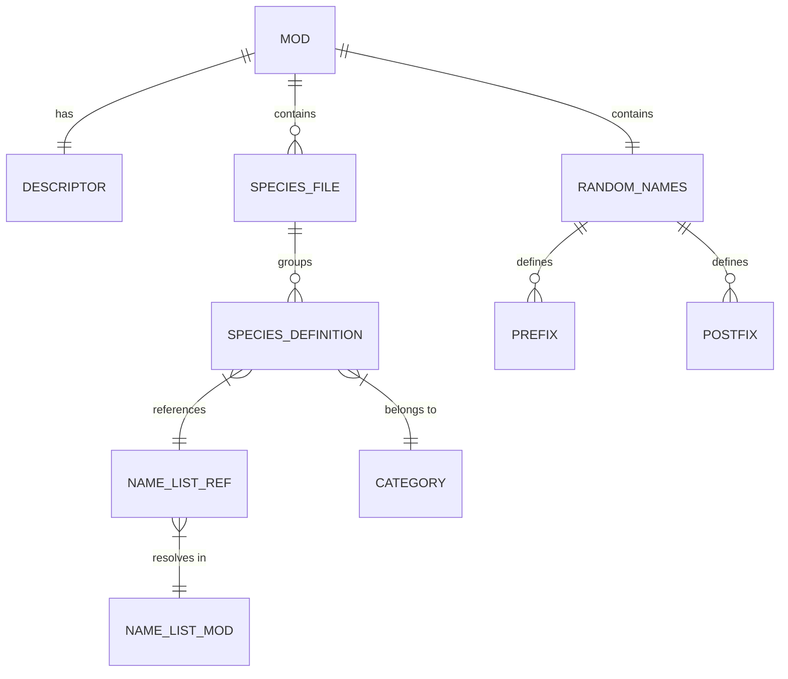

# Data Model

## Domain Entities

### Species Definition

Represents a single species entry in a name list file.

| Field | Type | Required | Description |
|-------|------|----------|-------------|
| `species_key` | String | Yes | Unique identifier (lowercase, no spaces) |
| `name` | String | Yes | Singular display name (Title Case) |
| `plural` | String | Yes | Plural display name (Title Case) |
| `home_planet` | String | Yes | Default home planet name (Title Case) |
| `home_system` | String | Yes | Default home system name (Title Case) |
| `name_list` | String | Yes | Reference to name list in Name Lists mod |

**Example:**
```txt
bamuth = {
    name = "Bamuth"
    plural = "Bamuthi"
    home_planet = "Bamuthima"
    home_system = "Bamuth"
    name_list = "ui_extra_art1"
}
```

### Species Category

Groups species definitions by species class or theme.

| Category Code | Species Class | File Prefix |
|---------------|---------------|-------------|
| `ART` | Arthropoid (insectoid) | `ui_species_extra_arthropoid` |
| `AVI` | Avian (bird-like) | `ui_species_extra_avian` |
| `FUN` | Fungoid (fungus-like) | `ui_species_extra_fungoid` |
| `HUM` | Humanoid (human-like) | `ui_species_extra_humanoid` |
| `MAM` | Mammalian (mammal-like) | `ui_species_extra_mammalian` |
| `MOL` | Molluscoid (mollusc-like) | `ui_species_extra_molluscoid` |
| `PLA` | Plantoid (plant-like) | `ui_species_extra_plantoid` |
| `REP` | Reptilian (reptile-like) | `ui_species_extra_reptilian` |
| Custom | Media packs | `ui_species_media_{theme}` |

### Name List Reference

Links a species definition to a name list defined in the Name Lists mod.

| Field | Value | Source |
|-------|-------|--------|
| `name_list` | `ui_extra_art1` | Name Lists mod |
| `name_list` | `ui_extra_avi1` | Name Lists mod |
| `name_list` | `ui_extra_fun1` | Name Lists mod |
| `name_list` | `ui_extra_hum1` | Name Lists mod |
| `name_list` | `ui_extra_mam1` | Name Lists mod |
| `name_list` | `ui_extra_mol1` | Name Lists mod |
| `name_list` | `ui_extra_pla1` | Name Lists mod |
| `name_list` | `ui_extra_rep1` | Name Lists mod |
| `name_list` | `ui_dnd_kobold` | Name Lists mod |
| `name_list` | `ui_dw_*` | Name Lists mod |
| `name_list` | `ui_es_*` | Name Lists mod |
| `name_list` | `ui_gc_*` | Name Lists mod |
| `name_list` | `ui_nar_*` | Name Lists mod |

### Species Modification Parts

Prefixes and postfixes used when a species is genetically modified.

| Type | Values | Usage |
|------|--------|-------|
| Prefix | `Alpha_`, `Altered_`, `Arch-`, `Elite_`, `Great_`, `Master-`, `New_`, `Prime_`, `Super-`, `Supreme_` | Prepended to species name |
| Postfix | `Magnus`, `Majoris`, `Maximus`, `Mutant`, `Novus`, `Primus`, `Supremus` | Appended to species name |

### Mod Metadata

Describes the mod for Stellaris and distribution platforms.

| Field | Type | Value | Description |
|-------|------|-------|-------------|
| `version` | String | `1.7.4` | Mod version (semantic) |
| `name` | String | `Universum Infinitum: Species Names` | Display name |
| `path` | String | `mod/ui-species-names` | Install path relative to mod directory |
| `tags` | Array | `["Species"]` | Categorisation tags |
| `supported_version` | String | `4.5.*` | Stellaris version compatibility (wildcard) |

## Relationships



## Persistence

### Storage Format

All data is stored as **static text files** in the repository and mod directory:

| Data | File | Format | Encoding |
|------|------|--------|----------|
| Mod metadata | `descriptor.mod`, `ui-species-names.mod` | Key-value with nested blocks | UTF-8, LF |
| Species definitions | `species_names/*.txt` | Stellaris declarative syntax | UTF-8, LF |
| Modification parts | `random_names/base/ui-species-names.txt` | Stellaris declarative syntax | UTF-8, LF |

### Lifecycle

1. **Authoring** — Contributors edit text files in repository
2. **Release** — Files packaged into mod archive (zip)
3. **Distribution** — Published to Steam Workshop, Paradox Mods, Nexus Mods, GitHub Releases
4. **Installation** — User places mod directory in Stellaris mod folder
5. **Runtime** — Stellaris reads files at game startup, parses into memory
6. **Gameplay** — In-memory registry used for empire creation, species generation

### No Database

This mod uses **no database, no cache, no persistent runtime state**. All data is:
- Static at rest (text files)
- Parsed at game startup
- Held in memory during game session
- Discarded on game exit

## Consistency

### Invariants

1. **Unique species keys** — Each `species_key` must be unique across all files in this mod
2. **Valid name_list references** — Every `name_list` must exist in Name Lists mod
3. **Matching descriptors** — `ui-species-names.mod` and `descriptor.mod` must be identical
4. **Supported version format** — `supported_version` must use wildcard pattern (e.g., `4.5.*`)
5. **Category validity** — Base classes must use standard codes (ART, AVI, FUN, HUM, MAM, MOL, PLA, REP)

### Validation Points

| Check | When | Tool |
|-------|------|------|
| Descriptor identity | Release packaging | Manual / script |
| Syntax validity | Game startup | Stellaris parser |
| Reference resolution | Game startup | Stellaris name list processor |
| Duplicate keys | Game startup | Stellaris (undefined behaviour) |

## Migration

### Schema Evolution

The Stellaris declarative format is **controlled by Stellaris**, not this mod. Changes to the format require:
1. Stellaris update changes format
2. Mod updates to match new format
3. Mod `supported_version` updated

### Version Compatibility

| Mod Version | Stellaris Version | Notes |
|-------------|-------------------|-------|
| 1.7.4 | 4.5.* | Current |
| Future | 4.6.* | Update `supported_version` |
| Future | 5.0.* | May require format changes |

### Data Migration

No data migration needed — mod files are replaced entirely on update. No user data stored.